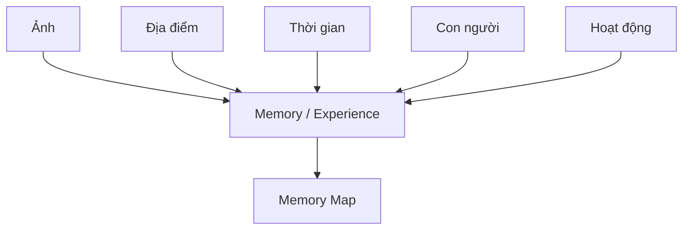

<div align="center">


# Mori - Memory Map

### Your life, mapped.

**Những nơi đã đến. Những người đã gặp. Những khoảnh khắc trở thành một phần của bạn.**

Android Application · Kotlin · Jetpack Compose · Personal Project

</div>

## Tổng quan nhanh

| Thông tin | Nội dung |
|---|---|
| Tên dự án | **Mori - Memory Map** |
| Thương hiệu | Mori |
| Loại sản phẩm | Personal Android Application |
| Phát triển cá nhân | **Trần Đức Trung** |
| Đối tượng chính | Gen Z, sinh viên, người trẻ |
| Nền tảng | Android native |
| Giai đoạn hiện tại | Phát triển Android trên nền thiết kế Figma |
| Trạng thái phát triển | **Đã có bản triển khai cục bộ; đang tiếp tục kiểm thử và hoàn thiện** |

## Mục lục

- [Giới thiệu](#1-giới-thiệu-dự-án) · [Bài toán thực tế](#2-bài-toán-thực-tế)
- [Giải pháp](#3-giải-pháp-của-mori) · [Tính năng](#4-tính-năng)
- [Đối tượng người dùng](#5-đối-tượng-người-dùng) · [Điểm khác biệt](#6-điểm-khác-biệt)
- [User Flow](#7-user-flow-chính) · [UI/UX Design](#8-uiux-design)
- [Tech stack](#9-tech-stack) · [Trạng thái dự án](#10-trạng-thái-dự-án)
- [Roadmap](#11-roadmap) · [Phát triển cá nhân](#12-phát-triển-cá-nhân)
- [Repository & Setup](#13-repository--setup) · [Hướng phát triển](#14-hướng-phát-triển)
- [Quyền riêng tư](#15-quyền-riêng-tư) · [Project Philosophy](#16-project-philosophy)

## 1. Giới thiệu dự án

**Mori - Memory Map** là dự án ứng dụng Android cá nhân được tôi tiếp tục phát triển từ ý tưởng lưu giữ ký ức theo địa điểm. Mori hướng đến việc lưu giữ và khám phá lại trải nghiệm bằng cách kết nối **ảnh, địa điểm, thời gian, con người và hoạt động** thành một **Memory / Experience** — một ký ức có bối cảnh.

Đối tượng cốt lõi của Mori là **trải nghiệm**. Thư viện ảnh giúp người dùng duyệt nội dung; Mori tập trung vào mối liên hệ giữa những khoảnh khắc để người dùng nhớ lại một chuyến đi, buổi gặp gỡ hoặc cột mốc cá nhân. Ý tưởng này đặt trải nghiệm sống làm trung tâm của việc tổ chức ký ức.

> **Mori không chỉ lưu ảnh — Mori lưu lại nơi cuộc sống đã diễn ra.**
>
> *Photos capture moments. Mori connects them into your life.*

## 2. Bài toán thực tế

Người trẻ thường chụp nhiều ảnh, nhưng việc lưu ảnh chưa đồng nghĩa với việc giữ được toàn bộ câu chuyện:

- Ảnh nằm rời rạc trong thư viện; ký ức cũ dễ chìm giữa hàng nghìn nội dung.
- Sau một thời gian, người dùng có thể quên nơi chụp, người đi cùng hoặc hoạt động hôm đó.
- Một chuyến đi có hàng trăm ảnh nhưng thiếu cấu trúc để tái hiện hành trình theo thời gian.
- Mối liên hệ giữa ảnh, người, địa điểm và thời gian chưa luôn rõ ràng, khiến việc khám phá lại trải nghiệm mất nhiều công sức.

Mori được đề xuất để giúp người dùng tìm lại **ý nghĩa và bối cảnh** của những gì đã lưu, thay vì phải tự ghép lại từng chi tiết.

## 3. Giải pháp của Mori

Mori dự kiến nhóm các khoảnh khắc liên quan thành một Experience, bổ sung bối cảnh và đặt trải nghiệm đó lên bản đồ cá nhân. Mỗi Memory là một câu chuyện có thể xem lại qua ảnh, hành trình và những người cùng tham gia.



### Ví dụ: Nha Trang Trip 2026

**Tình huống minh họa:** người dùng đi Nha Trang trong **3 ngày**, có **127 ảnh**, **6 địa điểm** và **4 người bạn**. Đây là số liệu giả định để giải thích ý tưởng, không phải kết quả xử lý của ứng dụng đã triển khai.

Theo định hướng sản phẩm, Mori có thể đề xuất **Nha Trang Trip 2026**: một Memory gồm thư viện ảnh, địa điểm, tuyến đường, timeline từng ngày, người tham gia, ảnh đóng góp qua Shared Memory và các khoảnh khắc nổi bật.

| Ngày | Hành trình minh họa |
|---|---|
| Ngày 1 | Khách sạn → Nhà hàng → Bãi biển |
| Ngày 2 | Đảo → Quán cà phê → Chợ đêm |
| Ngày 3 | Ăn sáng → Trở về nhà |

Người dùng có thể xem lại chuyến đi như một trải nghiệm liền mạch, đồng thời mở từng ảnh khi muốn nhớ một khoảnh khắc cụ thể.

## 4. Tính năng

Mori đang được phát triển theo từng luồng nhỏ. Bảng dưới phân biệt phần đã có trong bản Android cục bộ với những phần còn nằm trong kế hoạch. Các mục đã có mã triển khai vẫn cần tiếp tục kiểm thử; chưa phải bản phát hành hoàn chỉnh.

| Tính năng | Phạm vi | Trạng thái |
|---|---|---|
| **Memory Map** | Bản đồ Vietmap qua MapLibre, ghim ảnh từ ký ức cục bộ có tọa độ. | Đã có bản cục bộ |
| **Built-in Camera** | Chụp ảnh, xem trước và chuyển tới luồng tạo ký ức. | Đã có bản cục bộ |
| **GPS & Timestamp** | Lưu thời gian và vị trí khi được người dùng cho phép. | Đã có bản cục bộ |
| **Local Memory Save** | Lưu ảnh và chỉ mục ký ức trong bộ nhớ riêng của ứng dụng. | Đã có bản cục bộ |
| **Memory Detail** | Xem lại ảnh, nội dung và thông tin vị trí của một ký ức. | Đã có bản cục bộ; tiếp tục mở rộng |
| **Memory Timeline** | Xem các ký ức cục bộ theo dòng thời gian. | Đã có bản cục bộ |
| **Search** | Tìm ký ức theo nội dung và tên địa điểm khi có. | Đã có bản cục bộ; bộ lọc còn mở |
| **Authentication** | Firebase Authentication, quản lý phiên và đăng xuất. | Đã triển khai; một số luồng còn cần kiểm thử |
| **Place Names** | Lấy tên địa điểm qua Android Geocoder; fallback về tọa độ. | Đã có bản cục bộ |
| **Gallery Import** | Chọn và nhập ảnh có sẵn trên thiết bị. | Dự kiến |
| **Memory Grouping** | Nhóm ảnh theo bối cảnh thời gian, vị trí thành một Experience. | Dự kiến |
| **Suggested Memory** | Đề xuất nhóm ảnh có thể thuộc cùng một trải nghiệm. | Dự kiến |
| **Memory Route** | Tái hiện tuyến đường của trải nghiệm. | Dự kiến |
| **Shared Memory** | Nhiều người cùng đóng góp ảnh cho một trải nghiệm. | Dự kiến |
| **Friends & Our Map** | Kết nối bạn bè và xem những ký ức chung. | Dự kiến |
| **On This Day** | Gợi lại ký ức vào cùng ngày trong quá khứ. | Dự kiến |
| **You Are Here Again** | Gợi lại trải nghiệm khi quay lại địa điểm cũ. | Dự kiến |
| **Life Statistics** | Thống kê ký ức, địa điểm và hành trình cá nhân. | Dự kiến |
| **Yearly Recap** | Kể lại hành trình trong năm bằng một câu chuyện trực quan. | Dự kiến |

## 5. Đối tượng người dùng

- **Gen Z, sinh viên và người trẻ khoảng 18–30 tuổi:** thường xuyên chụp ảnh và muốn lưu lại hành trình cá nhân.
- **Nhóm bạn, cặp đôi:** muốn tập hợp những khoảnh khắc chung từ nhiều người.
- **Người thích du lịch và lưu giữ kỷ niệm:** muốn xem lại nơi đã đến, người đã gặp và trải nghiệm đã có.

Mori được định hướng là ứng dụng di động dành cho người dùng cá nhân: **đơn giản, giàu cảm xúc, trực quan, dễ sử dụng và mobile-first**.

## 6. Điểm khác biệt

Điểm khác biệt nằm ở **định hướng tổ chức sản phẩm**: từ nội dung ảnh sang trải nghiệm có bối cảnh. Bảng dưới mô tả hai cách tiếp cận; các tính năng có thể giao thoa với những ứng dụng ảnh hiện có.

| Cách tiếp cận lấy media làm trung tâm | Mori - Memory Map |
|---|---|
| Media / Photo first | Experience first |
| Album ảnh | Memory / Experience |
| Ảnh theo thời gian | Timeline của một trải nghiệm |
| Dữ liệu vị trí của ảnh | Memory Map của các trải nghiệm |
| Từng ảnh riêng lẻ | Ảnh + người + địa điểm + thời gian + hoạt động |
| Album cá nhân | Shared Memory với người cùng tham gia |
| Tổng kết media | Tổng kết trải nghiệm và hành trình sống |

> **Core idea: Mori organizes experiences, not just photos.**

## 7. User Flow chính

Luồng chụp và lưu ký ức đã có bản triển khai cục bộ. Các luồng nhập ảnh, gợi nhắc và chia sẻ cùng bạn bè bên dưới vẫn mô tả định hướng phát triển.

### Chụp và lưu ký ức

Memory Map → Camera → Capture Photo → GPS + Time → Photo Preview → Create / Add Memory → Save → Memory Marker → Memory Detail

### Nhập ảnh thành ký ức — dự kiến

Gallery → Import Photos → Suggested Memory → Review → Create Memory → Memory Map

### Khám phá lại ký ức — dự kiến

Notification / On This Day → Past Memory → Memory Detail

### Trải nghiệm cùng bạn bè — dự kiến

Friends → Friend Profile → Our Map → Shared Memory

## 8. UI/UX Design

**Thiết kế UI/UX và prototype tương tác đã được chuẩn bị trong Figma.** Mori hướng đến phong cách hiện đại, tối giản, thân thiện với Gen Z; giàu cảm xúc, có độ tinh tế và khuyến khích khám phá. Nhiếp ảnh là nội dung trung tâm của giao diện.

- **Nhận diện:** icon Mori hiện tại lấy trực tiếp từ component **Brand/Logo** trong Figma; sử dụng tông kem, cam đào và hồng san hô.
- **Hình ảnh và bề mặt:** ảnh có sắc thái ấm, bề mặt kính, thẻ bo góc và bóng nhẹ.
- **Bố cục:** phân cấp rõ, ít chi tiết thừa, ưu tiên nội dung ký ức và hành động chính.
- **Tương tác:** thiết kế mobile-first, thao tác dễ hiểu, phù hợp việc xem ảnh và khám phá bản đồ trên điện thoại.

<details>
<summary><strong>Xem các màn hình đã thiết kế</strong></summary>

| Nhóm màn hình | Màn hình chính |
|---|---|
| Onboarding & Authentication | Splash, Onboarding, Login, Register, Forgot Password, Permissions |
| Map & Camera | Memory Map, Selected Marker, Map Filter, Camera, Memory Mode, Photo Preview |
| Memories | Create Memory, Import Photos, Suggested Memory, Memory Detail, Memory Gallery, Photo Viewer, Memory Route, Memory Timeline |
| Discovery | Main Timeline, Search, Search Results, On This Day, You Are Here Again |
| Friends | Friends, Friend Profile, Our Map, Shared Memory, Invite Friends |
| Reflection | Life Statistics, Yearly Recap |
| Account | Profile, Settings, Privacy, Permission Settings |

</details>

### Design & Prototype

Thiết kế và prototype được quản lý trong Figma. Icon trong README được xuất trực tiếp từ bản thiết kế hiện tại và lưu cùng repository tại `assets/mori-icon.png`.

## 9. Tech stack

Bản Android hiện được triển khai bằng Kotlin và Jetpack Compose. Phần lưu ký ức dùng dữ liệu cục bộ; Firebase Authentication phục vụ xác thực tài khoản. Cloud storage và đồng bộ ký ức chưa hoàn thiện.

| Technology | Purpose | Status |
|---|---|---|
| Kotlin | Ngôn ngữ lập trình Android. | Đang sử dụng |
| Android Studio | Môi trường phát triển. | Đang sử dụng |
| Jetpack Compose & Material 3 | Giao diện native và các thành phần dùng chung. | Đang sử dụng |
| ViewModel, StateFlow & Coroutines | Quản lý trạng thái và tác vụ bất đồng bộ. | Đang sử dụng |
| CameraX | Chụp ảnh trong ứng dụng. | Đang sử dụng |
| MapLibre Native & Vietmap | Bản đồ raster và ghim ký ức. | Đang sử dụng |
| Firebase Authentication | Xác thực và quản lý phiên. | Đã tích hợp; tiếp tục kiểm thử |
| Credential Manager | Hỗ trợ luồng đăng nhập. | Đã tích hợp; tiếp tục kiểm thử |
| App-private files & JSON index | Lưu ảnh và chỉ mục ký ức cục bộ. | Đang sử dụng |
| Android Geocoder | Lấy tên địa điểm từ tọa độ. | Đã triển khai; còn quyết định privacy trước phát hành |
| Git & GitHub | Quản lý phiên bản và repository cá nhân. | Đang sử dụng |
| Firestore / Cloud Storage | Dữ liệu chia sẻ và đồng bộ. | Chưa triển khai đầy đủ |

## 10. Trạng thái dự án

> **Current Stage:** `Android Development & Validation`

Bản Android cục bộ đã có các luồng chụp, lưu và xem ký ức. Repository này hiện công khai phần README và asset nhận diện; mã nguồn ứng dụng sẽ được đưa lên theo từng tính năng sau khi kiểm tra.

| Hạng mục | Trạng thái |
|---|---|
| Ý tưởng và định hướng sản phẩm | Đã xác định |
| User Flow, UI/UX Design và Figma Prototype | Đã có thiết kế; tiếp tục đối chiếu khi triển khai |
| Android Project Setup | Đã có |
| Camera, local save và xem lại ký ức | Đã có bản cục bộ |
| Memory Map, Timeline, Detail và Search | Đã có bản cục bộ |
| Authentication | Đã triển khai; còn luồng cần kiểm thử thêm |
| Bottom Navigation | Đã có bản icon-only; tiếp tục kiểm chứng giao diện và hiệu năng |
| Local storage | Đã có |
| Cloud / Social features | Chưa hoàn thiện |
| Testing | Đã có kiểm thử; thiết bị thật và các mức nghiệm thu còn mở |
| Release | Chưa phát hành |

## 11. Roadmap

Mori được phát triển theo từng phần: hoàn thiện luồng cục bộ trước, sau đó mới mở rộng chia sẻ và các tính năng nhìn lại hành trình. Danh sách dưới thể hiện tiến độ triển khai, không thay cho kết quả nghiệm thu toàn ứng dụng.

<details>
<summary><strong>Xem kế hoạch theo 4 giai đoạn</strong></summary>

### Giai đoạn 1 — Ý tưởng & thiết kế

- [x] Xác định ý tưởng và người dùng mục tiêu
- [x] Chuẩn bị User Flow
- [x] Chuẩn bị UI/UX Design và Figma Prototype
- [ ] Nghiệm thu toàn bộ giao diện Android theo phạm vi triển khai

### Giai đoạn 2 — Nền tảng Android & ký ức cục bộ

- [x] Thiết lập dự án Kotlin + Jetpack Compose
- [x] Triển khai điều hướng và các luồng xác thực
- [x] Camera → Photo Preview → lưu ký ức cục bộ
- [x] Memory Map, Timeline, Memory Detail và Search cục bộ
- [x] Bổ sung tên địa điểm từ Geocoder
- [ ] Kiểm chứng đầy đủ các luồng trên thiết bị thật
- [ ] Gallery Import và các thao tác quản lý ký ức còn lại

### Giai đoạn 3 — Chia sẻ & nhìn lại hành trình

- [ ] Cloud sync
- [ ] Friends, Shared Memory và Our Map
- [ ] On This Day và You Are Here Again
- [ ] Memory Grouping và Suggested Memory
- [ ] Life Statistics và Yearly Recap

### Giai đoạn 4 — Chất lượng & phát hành

- [ ] Hoàn thiện responsive, accessibility và lifecycle regression
- [ ] Đo và tối ưu hiệu năng trên thiết bị thật
- [ ] Chốt chính sách dữ liệu, Geocoder và quyền riêng tư
- [ ] Hoàn thiện điều kiện bản đồ, tài khoản và phát hành
- [ ] Chuẩn bị bản thử nghiệm và bản phát hành khi đủ điều kiện

</details>

## 12. Phát triển cá nhân

| Thông tin | Nội dung |
|---|---|
| Người phát triển và quản lý repository | **Trần Đức Trung** |
| GitHub | [@DucTrung1211](https://github.com/DucTrung1211) |
| Repository | [DucTrung1211/mori-android](https://github.com/DucTrung1211/mori-android) |
| Phạm vi | Triển khai Android, kiểm thử và tiếp tục phát triển Mori theo từng tính năng. |

Mori bắt đầu từ ý tưởng của dự án nhóm. Repository này dành cho phần triển khai Android và quá trình phát triển cá nhân của tôi; không phải repository quản lý thành viên hoặc phân công công việc của nhóm.

## 13. Repository & Setup

### Repository

- **Repository:** [DucTrung1211/mori-android](https://github.com/DucTrung1211/mori-android)
- **Default branch:** `main`
- **Feature branches:** `feat/<feature-name>`
- **Bug fixes:** `fix/<issue-name>`
- **Documentation:** `docs/<topic>`

Tên branch, file, code identifiers và commit message dùng tiếng Anh. Nội dung giới thiệu và hướng dẫn dùng tiếng Việt; tên công nghệ và thuật ngữ kỹ thuật giữ cách gọi thông dụng.

### Prerequisites

- Android Studio và Android SDK phù hợp với cấu hình source.
- JDK 21.
- Thiết bị Android hoặc emulator từ API 26 trở lên.
- Cấu hình Firebase và khóa Vietmap dành cho môi trường phát triển của bạn.

### Getting started

**Các bước này áp dụng sau khi mã nguồn Android được đưa lên repository.** Hiện repository chưa chứa source để build app.

```bash
git clone https://github.com/DucTrung1211/mori-android.git
cd mori-android
```

Mở dự án bằng Android Studio, cấu hình SDK trong `local.properties`, đặt Firebase config tại `app/google-services.json` khớp application ID `com.mori.memorymap`, thêm `VIETMAP_TILEMAP_KEY` vào `local.properties`, rồi đồng bộ Gradle và chạy module `app`.

### Build & Test

Windows:

```powershell
.\gradlew.bat :app:testDebugUnitTest :app:assembleDebug
```

macOS / Linux:

```bash
./gradlew :app:testDebugUnitTest :app:assembleDebug
```

Không đưa cấu hình riêng, khóa API, keystore hoặc build output lên Git. Build pass chỉ xác nhận mức build/test đã chạy; runtime, visual, interaction và performance cần bằng chứng riêng.

## 14. Hướng phát triển

**Ý tưởng tương lai, ngoài phạm vi MVP và chưa phải cam kết triển khai:**

- **Kể chuyện:** AI-generated Memory Story, Video Recap, Physical Photo Book.
- **Khám phá thông minh:** Smart Memory Detection, Activity Recognition, Smart Recommendations.
- **Ký ức chung:** Advanced Shared Memories, Couple Map, Friend Map.
- **Trải nghiệm mở rộng:** AR Memories, Memory Passport, Memory Badges và thống kê cá nhân nâng cao.

## 15. Quyền riêng tư

Mori liên quan đến ảnh, vị trí, con người và trải nghiệm cá nhân. Các nguyên tắc sản phẩm cần được giữ xuyên suốt thiết kế và phát triển:

- Memory **riêng tư mặc định**.
- Vị trí lịch sử không tự động được công khai.
- Shared Memory chỉ được chia sẻ khi người dùng chủ động lựa chọn.
- Chỉ yêu cầu quyền vị trí khi cần cho trải nghiệm liên quan.
- Giải thích rõ mục đích sử dụng quyền camera, ảnh và vị trí.

Bản hiện tại lưu ảnh và chỉ mục ký ức trong bộ nhớ riêng của ứng dụng. Bản đồ cần kết nối tới Vietmap khi chưa có dữ liệu trong cache.

Android Geocoder có thể gửi tọa độ tới nhà cung cấp của thiết bị để lấy tên địa điểm, kèm thông tin mạng do nhà cung cấp xử lý. Vì vậy, không coi toàn bộ việc xử lý vị trí là chỉ diễn ra trên máy. Cách gọi Geocoder và khai báo privacy cần được chốt trước khi phát hành.

Các cơ chế chia sẻ, đồng bộ cloud và kiểm soát truy cập cho ký ức dùng chung vẫn là phần cần tiếp tục triển khai và kiểm chứng.

## 16. Project Philosophy

> ### “This isn't where my photos are stored.
> ### This is where my life happened.”

<div align="center">

**Mori - Memory Map**

*Your life, mapped.*

</div>

---

<div align="center">

Phát triển và quản lý bởi **Trần Đức Trung**.

**Mori - Memory Map · Personal Project · 2026**

</div>
